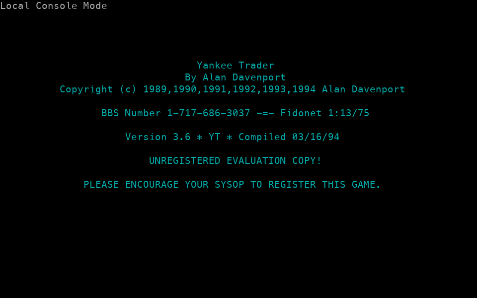
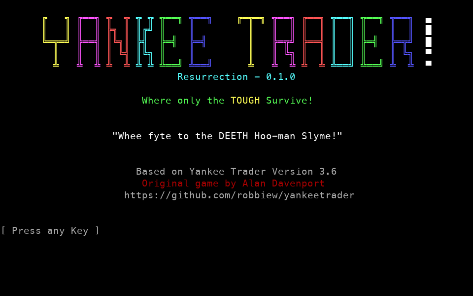
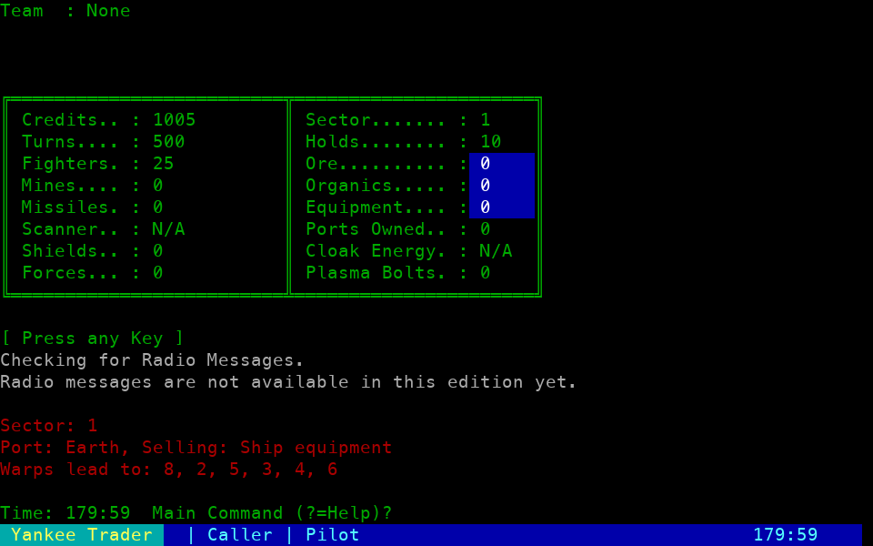
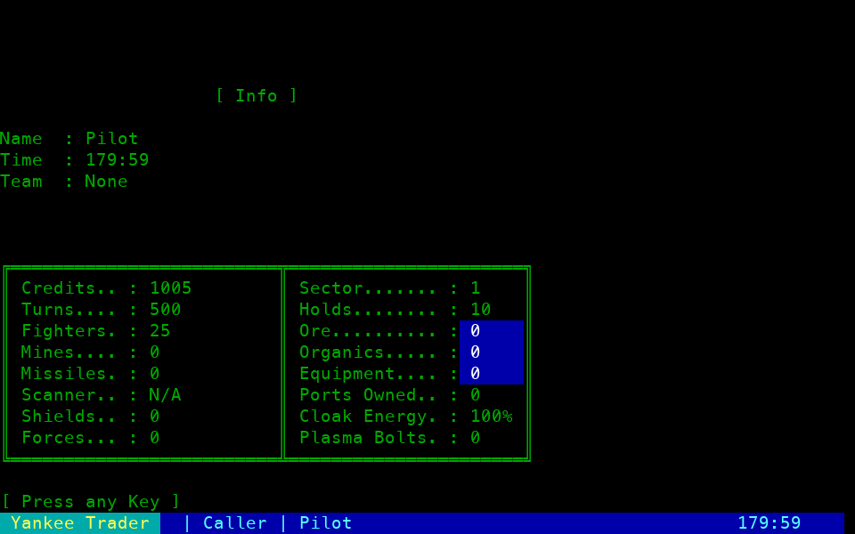
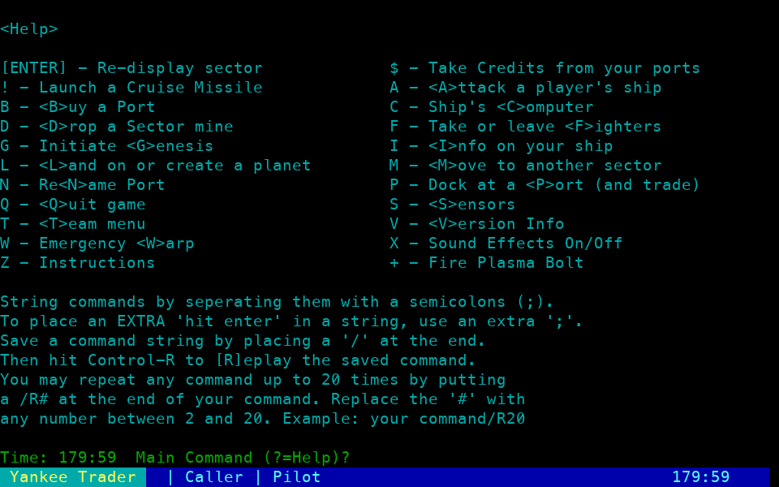
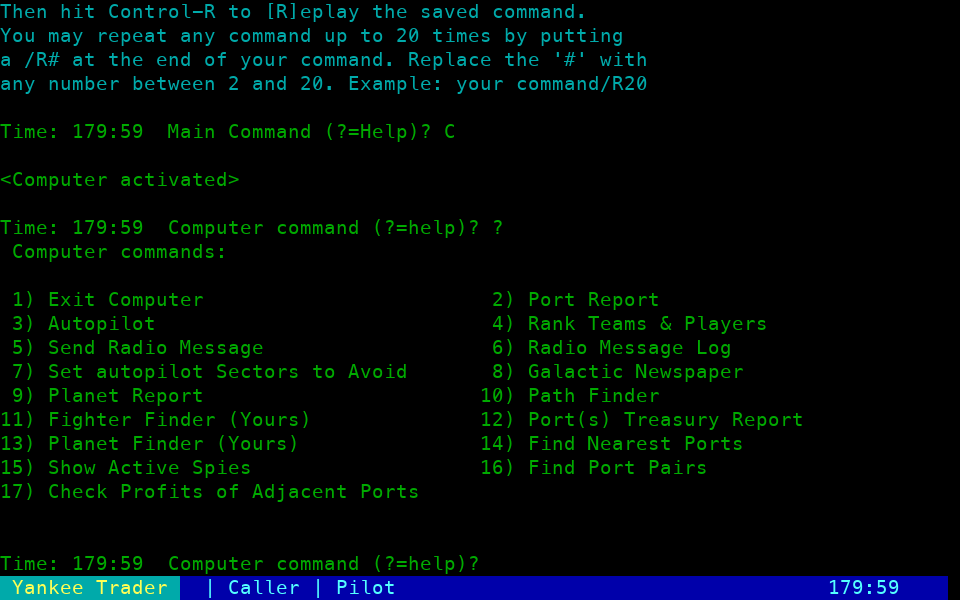

# Yankee Trader: Resurrection

Version **0.1.0**, with the original game by Alan Davenport, based on Yankee Trader Version 3.6. A reconstruction for local play and BBS doors, built with Go/GoDoors. The first playable milestone supports persistent players, sector navigation, cloak-aware adjacent-sector sensors, directed path finding and confirmed autopilot, cargo trading, Earth equipment purchases, automatic saves, and planet creation, production, transfers and banking, plus port buyouts, personal treasury collection, teams/shared planets, and daily port/planet production and turn maintenance. The original DOS distribution and research evidence are untouched. The app name, semantic version, original creator and version, and repository link come from [`internal/version`](internal/version/version.go); run `./bin/yt -version` to display the release identity.

## Status

Bounded plasma launching is now available in-game to test. Use `PLASMA <sector> <quantity>` or classic `+` with 1–64 bolts and fresh confirmation. The shared energy pool follows directed routes, can be redirected by login-local black holes and can damage friendly, cloaked or your own ships and planets. Costs, damage, wreck mines and death/estate cleanup save atomically. Save version **26** adds explicit plasma death semantics; back up the stopped door and update all nodes together. [Rules and limits](research/yt-plasma/IMPLEMENTATION.md).

**Playable prototype (0.1.0).** The features below are available in the current Go game for testing. Availability does not mean complete DOS parity or live BBS acceptance; see [validation evidence](evidence/VALIDATION.md) for tested environments and limitations.

### Available in-game to test

- **Seasons:** confirmed Genesis endgame, authoritative port ownership, atomic universe reset, public winner history and epoch guards that end old logins.
- **Persistent play:** saved players and ships, reconnects, daily turns, port/planet production and banking interest, bounded daily super-planet awards, safe retirement of inactive dead accounts, port/planet plague and planetary civil war.
- **Navigation and trading:** sector movement, adjacent sensors, cloak detection/recharging, login-local anti-cloak activation, danger-scanner warnings, confirmed emergency warp, bounded automatic black-hole arrivals, path finding, confirmed autopilot, avoid lists, cargo trading, Earth purchases, confirmed paid lottery tickets, port buyouts and treasury collection.
- **Planets and teams:** planet creation, naming, production, banking, investment, cargo/weapon transfers and garrisons, confirmed thruster transport and forced landing, plus The Wanderer’s daily relocation/restoration and special one-edge transport; team creation/joining, captain controls and shared planet access.
- **Combat:** confirmed planetary ground assaults and ship fighter attacks, routed missiles and retaliation, confirmed plasma launches with bounded black-hole routing and indiscriminate damage, planetary ground/production bombardment and destruction, sector-fighter deployment/recovery, reinforcement, breach combat, surrender and escape. Death, loot, port settlement, replacement ships, wreck minefields and deliberate mine placement are connected to play.
- **Mercenaries and Xannor:** Mercenary bribery/recruitment, tax-funded hiring, daily routes, desertion and base restoration; Xannor HQ/home restoration, reclaim battles and bounded mobile groups. Mobile groups encounter mines, sector defenses, living ships and foreign planets with bounded battles and atomic aftermath. HQ victories award up to 1,000,000 exact credits, queue ship-bound revenge and publish a victory notice; private receipts show the amount actually added.
- **Computer and communication:** player/team rankings, commerce and planet reports, planet/port finders, trading forecasts, persistent direct radio and message history. Spies report mines, planets and sector defenses during the current login. The newspaper records logins, team creation, Xannor ship deaths, planetary assaults, daily awards/retirement, plague/civil-war events and HQ victories.
- **Presentation and door sessions:** DOS-style menus, ANSI/CP437 or plain text, compact commands, local play and Door32 sessions. Exit music is enabled for detected SyncTERM/CTerm terminals.

### Not shipped yet

- Remaining random-event and exact DOS RNG/numeric parity.
- Mercenary plasma sales, explicit season archive export/administrative reset tooling and remaining disruption spy intelligence.
- Broadcast/team radio, the DOS multiline message editor, ship/cloak and disruption spy intelligence, and remaining newspaper event types.
- Original DOS universe generation and save import/export, plus complete original RNG, rounding and other unresolved rule parity.

See [Play locally](#play-locally) for commands and the feature sections below for detailed rules and current limits.

## Screenshots

Captured from the current Go game in an 80×25 local ANSI terminal session.
The opening artwork capture includes the centered Resurrection version subtitle;
the startup smoke check verifies its alignment.
Click any screenshot to view it at full size.

<table>
  <tr>
    <td align="center"><a href="evidence/startup/title.png"></a><br>Title screen</td>
    <td align="center"><a href="evidence/startup/opening.png"></a><br>Opening artwork</td>
  </tr>
  <tr>
    <td align="center"><a href="evidence/startup/sector.png"></a><br>Sector view</td>
    <td align="center"><a href="evidence/startup/info.png"></a><br>Ship information</td>
  </tr>
  <tr>
    <td align="center"><a href="evidence/startup/help.png"></a><br>Command menu</td>
    <td align="center"><a href="evidence/startup/computer-help.png"></a><br>Ship computer</td>
  </tr>
</table>

## A little history

Yankee Trader is Alan Davenport's text-based BBS space strategy game, combining
exploration, trading and warfare. Its roots are in the Trade Wars 2 code base:
following Chris Sherrick's first Trade Wars in 1984, Davenport released Trade
Wars 1000 in 1987. The game took the Yankee Trader name in 1989, and its final
DOS release, version 3.6, arrived in 1994.

[Zharous's Yankee Trader strategy guide](https://yt.starflt.com/22-2/) records
that history and reports that Davenport's original QuickBASIC source was lost.
This project reconstructs the game in Go using the preserved DOS distribution
and captured behavior as references.

## DOS-style startup

The default interface adapts the preserved DOS title and opening art with
Resurrection branding, and reproduces the new-player
alias confirmation, instructions choice, ship-information pause, sector display
and first command menus. Use an 80×25 ANSI terminal for the recovered colors and
layout. Local terminals receive UTF-8 box characters; ANSI BBS callers receive
raw CP437. Door32's emulation field selects the remote display; `-ascii` forces
plain text. No terminal-size probes are required.

Press a key at the title, then a separate key after the opening artwork. Each
page stays visible until its own keypress. New players enter an in-game alias (Enter uses the
Door32 real name, or the local name), confirm with `Y`, and choose whether to read
the original instructions. Press a key after ship information. At the main
prompt, Enter redisplays the sector, `?` shows the original two-column help,
`C` enters the ship's computer, and `Q` asks for confirmation. Commands finish
with Enter and can be stacked with semicolons. A trailing `/` saves a command
line for Ctrl-R replay; `/R2` through `/R20` repeat a command.

In this interface `L` follows DOS and lands on a planet; `LOOK` displays the
sector. The compact interface keeps its existing `L` look binding. Use
`-compact` to skip the startup screens and retain the prior command workflow.
The computer connects options 2 (port report), 3 (autopilot), 4 (player/team rankings), 5 (send radio), 6 (message history), 7 (avoid slots),
8 (Galactic newspaper), 9 (planet report), 10 (path finder), 11 (your deployed sector fighters),
12 (port treasuries), 13 (your planets), 14 (nearest ports), 15 (active spies), 16 (port pairs),
and 17 (adjacent-port trade forecasts) to the implemented game rules.

The original menus and manual include features still under reconstruction.
Selecting an unavailable action says so; danger-scanner status reflects the installed hardware. Ship balances and inventory come from the current Go world,
including its existing deliberate differences from DOS starting equipment.
The startup screens identify this project as Yankee Trader: Resurrection
0.1.0, say “Original game by Alan Davenport” and “Based on Yankee Trader
Version 3.6,” and link to the
[GitHub repository](https://github.com/robbiew/yankeetrader). No registration
code is required. Original DOS artwork remains preserved in the archive.

See [startup evidence and limits](research/yt-startup/RECOVERY.md) and the
[title](evidence/startup/title.png), [ship information](evidence/startup/info.png),
and [main menu](evidence/startup/help.png) captures.

## Play locally

From the repository directory, build the game, create a world, and start a local
session (see [Build and validate](#build-and-validate) for prerequisites):

```sh
go build -o bin/yt ./cmd/yt
./bin/yt -data data -init
./bin/yt -data data -local Player
```

On Windows, build with `-o bin/yt.exe` and use `.\bin\yt.exe` in place of
`./bin/yt`. Replace `Player` with your local player name. For later sessions,
run only the local-play command with the same name and data directory.

For a separate new world, run `./bin/yt -data another-world -init`. Initialization refuses to overwrite an existing world; skip that step if you already have one. `-local` is for trusted local play; do not give remote callers control over that flag or the data directory. The data files live in `data`, separately from the DOS game. Every successful action saves before its result is displayed. Quitting or disconnecting never restores spent resources or turns.

Try this route to buy a fighter, buy five ore at sector 2, and sell it at sector 3:

```text
P; EQUIP fighters 1; M 2; P; BUY ore 5; M 3; P; SELL ore 5; I; Q
```

The expected starting-player result is 1,005 credits, 26 fighters, no cargo, sector 3, and 495 turns. Terminal commands are case-insensitive and can be stacked with semicolons.

| Command | Action |
|---|---|
| `?` | Help |
| `I` | Ship information |
| `LOOK` | Current sector, warps, and port (`L` in compact mode) |
| `M <sector>` | Move through a listed adjacent warp; one turn |
| `S` / `SCAN` | Scan adjacent sectors: ports, planets, ships and outgoing warps; free |
| `D` / `DROP [quantity]` | Place carried mines in the current sector outside sectors 1–7; fresh Y confirmation; no turn cost |
| `PATH <from> <to>` | Display a shortest directed warp route and turn cost; free |
| `AUTO <sector>` | Plot from your current sector, confirm with Y/N, then move one turn per hop |
| `AVOID` | Show your saved routing preferences; free |
| `AVOID <slot> <sector>` | Set slot 1–30; sector 0 clears that slot; free |
| `P` | Dock and display current prices; one turn |
| `T` / `TEAM` | Team menu: create/join, roster/resources, leave and captain controls |
| `B` / `ACQUIRE` | Buy the current port after explicit `Y` confirmation |
| `TREASURY` / computer `C`, `12` | Report personally owned port balances |
| `PORTREPORT [sector]` / computer `C`, `2` | Remote ordinary-port commerce report; free |
| `PLANETREPORT [sector]` / computer `C`, `9` | Remote planet report; a query blocked by sector fighters costs one turn |
| `RANK` / computer `C`, `4` | Rank players and teams from current assets and save all player scores; free |
| `RANK OLD` / computer `C`, `4`, `O` | Stored scores with current aliases, teams and port counts; free |
| `BATTLES` | Your private Xannor battle history; last 32 reports retained |
| `NEWS [TODAY|YESTERDAY]` / computer `C`, `8` | Read retained public news in five-entry pages; free |
| `HIRE <sector> [sector ...]` / Earth option `9` | Hire up to three spies per login, 333,000 credits each; choose every starting sector |
| `SPIES` / computer `C`, `15` | List this login's current spy hunt locations; free |
| `INTEL` | Read this login's last 30 intelligence reports in five-report pages; free |
| `RADIO [alias or player number]` / computer `C`, `5` | Compose a direct message, confirm recipient, then Send or Abort; free |
| `MESSAGES` / computer `C`, `6` | Your sent and received message history; free |
| `INBOX` | Unread received messages; free |
| `MYPLANETS` / computer `C`, `13` | List personally owned planets and sectors; free |
| `NEAREST [all\|own\|team\|enemy\|unowned]` / computer `C`, `14` | Nearest accessible ordinary ports, with directed warp distances; free |
| `NEAREST <ore\|organics\|equipment> <buy\|sell>` | Filter nearest ports by **your** trade action |
| `PAIRS` / computer `C`, `16` | Reachable adjacent-port pairs with complementary goods and a directed route back; free |
| `PROFITS` / computer `C`, `17` | Trade forecasts for your current port's outgoing adjacent ports; free |
| `$` / `COLLECT` | Collect all personal port balances from any sector |
| `BUY ore 5` / `SELL ore 5` | Trade cargo in the direction the port supports |
| `EQUIP fighters 1` / `EQUIP scanner 1` / `EQUIP cloak 10` | Buy Earth equipment; cloak is in whole percentage points |
| `ANTICLOAK` | Confirm a 500,000-credit activation for the current login while docked at Earth |
| `W` / `WARP` | Confirm a random emergency warp and its recharge/meltdown risk |
| `LEAVE` | Leave port |
| `Q` or Escape | Exit |

`RANK` publishes current player scores together, using supported ship assets,
actual ordinary-port ownership and personally deployed sector fighters. Team
rankings sum current members. `RANK OLD` reads the last published score values;
new accounts can show zero until an update. Dead accounts show zero, ties use
account/team order, and percentages use each list's leader. Rankings work with
zero turns and cost no assets. Reports show public totals, without private
account or planetary-bank fields.

Missile retaliation uses these published scores. Scores refresh on an explicit
updated ranking request, clean logout, and successful once-per-UTC-day
maintenance. An abrupt disconnect, declined logout or expired/stale session
does not trigger logout publication.
An installed danger scanner contributes its 250,000-credit asset value to live
scores; stored-score publication keeps the existing timing above. Individual scores
cap at 9,000,000,000,000,000 points. Other unsupported equipment, NPC rankings and
historical scoreboard files remain outside this slice. See [scoring rules,
cache timing and validation](research/yt-rankings/IMPLEMENTATION.md).

Direct radio accepts one printable ASCII line of up to 74 characters. Confirm a
recipient alias or player number, enter the body, then choose `S` to send or `A`
to abort. Message text and Send/Abort are separate inputs: semicolons and a
trailing slash in the body stay literal. Sender and recipient can read saved
history in five-message pages; other players cannot. Aliases are saved with the
message, and account history survives ship replacement. Sending costs no turns
or assets and works for offline recipients.

Unread messages appear at login and between commands, up to five per check;
`INBOX` reads the rest. A message becomes read only after successful terminal
output. A disconnect or simultaneous sessions can cause a repeated notification;
read messages remain in history, and senders receive no read receipts. The world
retains at most 4,096 messages and refuses new sends at capacity without deleting
history. Broadcast/team delivery and the DOS multiline editor remain open.
See [radio scope and validation](research/yt-navigation/RADIO_IMPLEMENTATION.md).

Sensors work even when no turns remain. `AUTO` asks before moving; an empty answer cancels. You can stack the response, for example `PATH 1 3; AUTO 3; Y; I`. Ctrl-X stops autopilot between hops. Every completed hop saves immediately and remains spent after interruption or disconnect. Courses stop if another session changes your position or leaves too few turns. See [navigation recovery and DOS comparisons](research/yt-navigation/RECOVERY.md).

`PATH` and `AUTO` honor your 30 private avoid slots, including the start and destination. For example, `AVOID 1 2` routes around sector 2; `AVOID 1 0` clears that preference. Manual `M` movement and sensors still work normally. Avoid edits cost no turns and persist across logins—an intentional improvement over the DOS session-only list. If a list edit makes a plotted course unsafe, autopilot stops before the next hop and keeps completed moves saved. Existing saves begin with an empty list.

Sensors show actual public sector/ship data. Danger-scanner purchasing and manual emergency warp are implemented below; sector-defense deployment and combat are available as described below. Minefields and safe automatic escape are implemented in the later milestones below. Cloak detection and direct fighter attacks are implemented in the later milestones below. Default worlds start without minefields; non-Earth combat wrecks can create them.

The default planet interface now follows the original DOS landing/report, help and transfer menus, with cyan text, original columns, gray answers and captured warning/receipt colors. Press `L` to land (or create a planet when none exists), `?` for planet help, `D` to redisplay, `N` to rename, `1`–`6`/`9` to take an item, Enter/`A` to take all, `T` to deposit items, `B` for the bank, `$` to invest, `F` to set the planetary garrison, and `L` to leave. Bank and garrison prompts ask for a **final target**, not a transfer amount. Empty bank/investment/garrison inputs cancel; empty take quantities choose the displayed maximum. Planet creation requires purchase and name confirmation. Landed `!` uses planetary thrusters. Denied landing can offer a separately confirmed ground assault; see [movement and ground actions](research/yt-planet-mobility/IMPLEMENTATION.md). See [37 captured planet stages and comparison boundaries](research/yt-planet-screens/RECOVERY.md).

Planet renaming uses the original name/confirmation prompts and colors. Blank names cancel; `N` at confirmation retries; Enter accepts. Names receive DOS word casing/space cleanup and are clipped to 41 characters. Renaming costs no credits or turns and uses the current landing permission, including shared/unguarded access. Reserved names and the final special planet slot remain protected. See [rename rules, 45 DOS captures and comparison boundaries](research/yt-planet-rename/RECOVERY.md).

Port colors, commodity columns, dotted labels, Earth menu spacing, and purchase prompts are checked against 35 original DOS screen captures from ten isolated sessions. The comparisons cover the port body through the current prompt, including Earth redraws, purchases, sales, ownership, full holds, and declined trades. Live timestamps and unsupported-item affordability remain dynamic; startup history, caller/status details, timing, and invalid-input behavior are outside this visual comparison. See [port screen evidence](research/yt-port-screens/RECOVERY.md).

Remote computer reports do not move, dock, land, or bind a trading price. Hostile
sector fighters hide both port and planet reports; only the blocked planet query
spends a turn, and it is refused when no turns remain. A defended foreign planet
shows just its name and ground forces. Unowned, unguarded, personally owned, and
currently shared team planets expose full reports. Full reports project current
production and interest without changing stored stock or money. The personal
planet finder excludes teammates' assets. Remote Earth equipment reports remain
unavailable; dock at Earth for its shop. See [report rules and validation](research/yt-navigation/REPORTS_IMPLEMENTATION.md).

Nearest-port and trade-route reports honor your avoid list and port-report
access. `B`/`S` in nearest results means **you buy/sell**. Team filters include
your own ports and current teammates' ports; enemy filters exclude both and
unowned ports. Results include projected quotes and whole-unit stock/demand.
Earth's equipment service is excluded. Reports also work with no turns left.

`PAIRS` and `PROFITS` show one positive commodity combination per port pair,
including approach, outward and return warp counts. A return route can require
several warps; a pair with no route back is omitted. The spread is the sum of
the two per-unit price differences, independent of cargo holds. It does not
promise ship earnings or account for cash, docking turns, or later changes in
prices and stock. Mines and defenses can still interrupt travel. Long reports
page four entries at a time; Enter shows more and Q stops. Each page refreshes
current access and prices, so changing state can change the remaining results.
See [trade-report scope and validation](research/yt-navigation/TRADE_REPORTS_IMPLEMENTATION.md).

In the default DOS-style interface, `P` opens Earth's numbered shop or the current port's cargo report. Earth keeps the original item numbers: `1` cloak energy, `2` holds, `3` fighters, `4` paid lottery, `5` danger scanner, `6` anti-cloak activation, `7` ground forces, `8` shields, `I` ship information, and `0` leave. Item `4` buys a five-credit, six-digit lottery ticket after a fresh Y confirmation; blank at ticket entry cancels. The default quota is five plays per UTC date, preserved across reconnects and replacement ships. Compact callers dock and use `LOTTERY [six digits]`. The saved receipt reports the actual draw, matches, fee, prize/cap adjustment, balance and plays remaining. An empty ordinary equipment quantity cancels that purchase. Cloak energy uses its displayed affordable/missing default on blank input; zero cancels. Selecting item `5` buys one scanner for 250,000 credits immediately, without a quantity prompt; duplicate or unaffordable purchases do not charge. The shop refreshes your credits after each saved purchase.

Ordinary ports offer commodities in ore/organics/equipment order. Enter a quantity (`0` skips), then agree with `Y` or Enter; `N` declines. Enter at the quantity prompt selects the displayed maximum, limited by current stock/demand, cargo space, cargo aboard, and credits. Invalid quantities skip that commodity without a transaction. Docking costs one turn, including a visit with no purchases. A replaced or expired docking session cannot complete an old prompt. `-compact` keeps the explicit `BUY`, `SELL`, and `EQUIP` workflow.

Other cargo names are `organics` and `equipment`. Earth sells `holds` (500 credits), `fighters` (100), `shields` (50), `forces` (750), and one `scanner` (250,000). Use `EQUIP scanner 1` in compact mode. Quantities must be whole, positive numbers. Cargo capacity is shared across all three cargo types. Earth equipment costs remain an economic sink.

## Run as a BBS door

Use the directory containing that node's Door32 drop file and the same absolute data directory on every node:

```sh
/path/to/yankeetrader/bin/yt \
  -data /path/to/yankeetrader/data \
  -drop /path/to/node1 \
  -system mybbs
```

`-system` is a stable namespace for the BBS. Identity uses this value plus the positive user-record number on Door32 line five; alias is display information. Changing an alias does not create a fresh ship. Keep the system value stable. Local identities are separate from Door32 identities.

GoDoors handles standard I/O on macOS/Linux and inherited Door32 sockets on supported Windows hosts. The door honors the drop file's remaining session time (1–1,440 minutes). The DOS-style interface supports ANSI/CP437 and plain text; `-compact` retains the original printable-ASCII command interface. Neither requires terminal probing.

Native macOS PTY and Door32 **local transport** were exercised. Linux/Windows builds compile, but this is not evidence of live acceptance under either BBS transport. Test an inherited Windows socket on the target BBS before deployment.

## Daily maintenance

```sh
./bin/yt -data data -maint
```

Port purchases cost `floor(sum of production / 10) + 1` credits and no turns. Buying an owned port pays its former owner the price plus its treasury, then clears that account. Earth cannot be bought. Confirmation defaults to cancellation and expires after five minutes; changed ownership, location, price or funds rejects the sale. Ownership changes invalidate docking agreements in the sector. Treasury collection is free, remote and personal; insufficient credit capacity rejects the entire collection. See [ownership evidence and deliberate fixes](research/yt-trade/OWNERSHIP.md).

Maintenance runs automatically at login as well. Days use **UTC**. On a new date it updates port supply, taxes ordinary port treasuries by `floor(treasury/10)`, restores players to 500 turns, and invalidates outstanding docking sessions. Repeating the command on the same day, or moving the clock backward, does not repeat daily phases. A missed interval gets at most ten days of port production; missing days do not accumulate extra player turns. Taxes and Mercenary desertion, routes, hiring and base restoration run once when advancing the maintenance marker, not once for every missed day.

Planet maintenance also produces stocks and weapons, grows rates and ground defenses, and pays bank interest. Inactive dead-player retirement runs before production; bounded Mercenary and Xannor actions and the one-shot super-planet lottery follow it. Other remaining daily phases are deferred. Cloak decay follows turn spending, rather than daily maintenance.

## Fidelity and deliberate changes

Implemented rules have links to the recovered evidence:

- Starting 1,005 credits, 25 fighters, 10 holds and 500 daily turns: [initializer evidence](research/dos-validation/RESULTS.md).
- Supply-sensitive cargo prices, quantity limits, demand depletion and owner commissions: [trading recovery](research/yt-trade/RECOVERY.md). Five saved DOS examples are exported in `internal/game/testdata/dos-trading.json` and checked by Go tests. These compare ore cash/cargo/treasury outcomes; they do not claim exact QuickBASIC RNG or floating-point equivalence.
- Port taxes and the repeated-maintenance defect: [maintenance recovery](research/yt-maint/RECOVERY.md).

Universe generation is a new seeded, reachable graph, not the recovered DOS generator. Default size is 3,000 sectors and 1,000 ports; `-sectors` allows 8–3,000 for small test games. Ports alternate cargo types and use fixed reference prices **20/30/40** until the DOS reference-price RNG is fully established. Shields start at zero in this prototype; shield initialization parity remains outside this milestone.

Known defects intentionally fixed here:

- Spendable money is `int64`, preserving one-credit debits at large balances across saves. It never uses MBF single precision.
- Earth cannot have an owner, and equipment spending cannot fund an owner treasury.
- Clock rollback preserves the last production watermark; it never awards ten days of goods.
- Daily phases have an actual persisted guard against same-day repeats.
- Each action loads authoritative state under the world lock. Failed actions commit nothing.
- Dock tokens expire after five minutes and are invalidated by movement, another docking, reconnect, or maintenance. Old sessions cannot apply a previous quote after another session changes the player's position.

Technical limits are 50 active accounts with a 256-identity lifetime archive (IDs are never reused), 1,000 cargo holds, 1 billion units per noncargo equipment category, and 9 quadrillion credits per account. These bounds are explicit prototype constraints, not claims about DOS overflow behavior.

Sector-defense deployment/combat and reinforcement, plus bounded Mercenary daily behavior, are playable. Xannor HQ/home lifecycle and bounded mobile groups are also implemented below. Full universe generation parity, DOS save import/export and remaining terminal menus are future milestones. Bounded Genesis resets are implemented below. Their recovered rules are in `research`.

## Storage and recovery

**Save rollback compatibility:** This build uses world version **26**, adding explicit plasma death semantics to the existing Wanderer identity, nonreusable planet generations, season epochs, public winner history, lottery replay protection, scanners, NPC history and attributed hazards. Supported version-1 through version-25 worlds upgrade in memory and persist on the next successful update; read-only loading does not rewrite saves or grant assets. Experimental legacy memberships without team metadata and pre-26 saves claiming a plasma death are rejected. Older binaries cannot read version 26.

Version 25 introduced The Wanderer's explicit identity in reserved planet slot 1; migration creates no free planet, and eligible restoration allocates a fresh incarnation. Version 24 introduced nonreusable planet generations. Season migration does not reset the world or invent past winner history, and names never infer a faction home or special planet identity. Back up the data directory with the door stopped and upgrade every node together. To revert binaries, restore their matching backup; that discards later progress. Migration preserves existing account assets and history; ordinary later maintenance may retire qualifying inactive dead accounts.

`world.json` is the versioned authoritative save. `world.lock` is a persistent lock-file name backed by an OS lock: process death releases the lock without deleting it. All processes must use the same data directory on a local filesystem. Network filesystems are not supported or tested.

Updates serialize through the lock, validate the complete world, write and sync a temporary file, then replace the save atomically on macOS/Linux. The containing directory is also synced there. Windows uses its file lock and replacement APIs but has not received native crash/durability acceptance. Orphan `.world-*` files are never treated as committed saves. Existing/corrupt saves are never silently reinitialized. Back up the data directory while the door is stopped, or take a filesystem snapshot.

If a save error occurs, stop and inspect the filesystem before retrying a purchase: an error syncing the directory after replacement can mean the new state is visible even though durability was not confirmed.

## Build and validate

CI allows 30 minutes for the complete race, evidence, terminal and cross-build
sequence. Wanderer-aware maintenance fixtures isolate unrelated production and
random encounters while retaining their resource, replay and durability checks.

Requires Go 1.23+ and a local GoDoors checkout at commit [`9364a49ddd7c396ccbfcdd3c240c104ea9178551`](https://github.com/robbiew/godoors/commit/9364a49ddd7c396ccbfcdd3c240c104ea9178551) or a descendant. That revision includes the timed-input API and preserves partial escape sequences across the 1 ms autopilot polls. `go.mod` currently replaces `github.com/robbiew/godoors` with `../godoors`, matching this workspace. For another checkout, point that replacement at the matching GoDoors source before building. No changes were made to the GoDoors repository.

```sh
go build -o bin/yt ./cmd/yt
go test -race ./...
go vet ./...
python3 scripts/smoke.py
python3 scripts/smoke_startup.py
python3 scripts/smoke_prompt_clock.py
python3 scripts/verify_port_screens.py
python3 scripts/smoke_port_parity.py
python3 scripts/verify_planet_screens.py
python3 scripts/smoke_planet_parity.py
python3 scripts/smoke_planet_parity.py --ascii
python3 scripts/verify_planet_rename.py
python3 scripts/smoke_planet_rename.py
python3 scripts/smoke_planet_rename.py --ascii
python3 scripts/verify_startup_evidence.py
python3 scripts/smoke_navigation.py
python3 scripts/verify_navigation_evidence.py
python3 scripts/verify_avoid_evidence.py
```

The smoke script also exercises planet creation, banking, investment, cargo transfers and reconnect. The smoke script uses a disposable world and real PTYs. It exercises GoDoors input/output, trading, equipment, movement, reconnect, repeated maintenance and Door32 local sessions with an alias change. Transcript: [local smoke evidence](evidence/local-smoke.txt).

The tests also cover rejected-action rollback, malformed saves, competing goroutines/processes, a killed lock holder, stale docking tokens, exact-money persistence, and DOS trading examples. Successful cross-compilation is recorded separately from native runtime/BBS validation in [validation evidence](evidence/VALIDATION.md).

## Planet management

The explicit commands below apply to `-compact`. The default interface uses the DOS planet menus described above.

`CREATE <name>` spends 25,000 credits and creates a planet in the current sector (one per sector, slots 2–100). It starts with production rates 1/1/1, stocks 10/10/10, 30 fighters, ground defense 1 and an empty bank. Creation does not land the ship or spend a turn.

| Command | Action |
|---|---|
| `LAND` / `PLANET` | Land, or display the landed planet |
| `BANK <target>` | Set the bank balance; move the difference to/from ship credits |
| `INVEST <credits>` | Spend credits to add credits/250 to each production rate |
| `TRANSFER cargo` | Unload all ship cargo; apply the recovered stock-based rate improvement |
| `TRANSFER fighters [quantity]` | Unload fighters; omitted quantity means all |
| `TRANSFER missiles [quantity]` | Unload missiles; mines and plasma work the same way |
| `TAKE <item> <quantity>` | Load whole units of cargo or weapons |
| `A` / `TAKEALL` | Load equipment, organics, ore in that order, then weapons |
| `GARRISON <target>` | Set planetary ground forces using the ship's ground forces; zero releases ownership |
| `LEAVE` | Leave the planet or port |

Owners, members of the same nonzero team, and visitors to unguarded planets can land. Permission and current position are rechecked on every action. Team membership and shared access are available through the team menu. Missile bombardment and separately confirmed ground assaults are available. A vacant unowned or dead governor can be adopted without spending carried troops; unrest reduces the existing garrison. Teammates and unguarded foreign visitors retain their existing access and governor.

Production uses elapsed time capped at ten days. Visiting grows rates before production; daily maintenance produces before growing rates, matching the two recovered DOS paths. Banking reevaluates surplus production after changing the balance. Fractional stock is retained; only whole units move aboard. See [planet recovery](research/yt-combat/RECOVERY.md) and the packaged reports in `research/yt-combat` for the original evidence (report filenames are preserved).

Money remains exact integer credits, including interest. This deliberately fixes the DOS large-balance banking exploit: even a one-credit deposit debits the ship. Empty transfers cannot increase production; failed or competing actions cannot duplicate goods. Clock rollback preserves the production watermark. Movement, reconnect and maintenance invalidate landing authorization.

Version-1 through version-25 worlds upgrade to version 26 in memory and are saved atomically on the next successful update, preserving existing players and assets. The local `data` and `bin` directories are ignored by Git. The original DOS distribution and full recovery workspace are preserved under `archive/`; portable supporting reports and compressed DOS snapshots are included under `research`.

## Complete recovery archive

The [complete archive](archive/README.md) includes the original DOS distribution, full experiments, Ghidra projects, player spreadsheet and [art/menu gallery](archive/analysis/art-menus/index.html). Run `python3 scripts/verify_archive.py` to verify all imported checksums. This repository is the working home for future recovery; the old Downloads folder is no longer required.

On exit, the original DOS tune plays only when GoDoors positively identifies
SyncTERM or another CTerm-compatible terminal using its device-attributes query.
Unknown terminals and `-ascii` sessions receive no music bytes. Music uses the
CTerm `CSI |` introducer and SO/SI terminators, avoiding the legacy `CSI M`
sequence that ordinary ANSI terminals interpret as delete-line.

## Teams

Press `T` (or `TEAM`) for the team menu. Create a team with a name of 3–41 printable characters and a four-character invitation password, or select a listed team to join. Passwords are case-insensitive, entered separately at a masked prompt, and stored as bcrypt hashes. Do not stack passwords with commands. Teams hold up to four members; joining and team management spend no credits or turns.

Members can view the roster and teammate planet locations, share defended teammate planets, and confirm departure. New deaths also remove membership. Only the current captain can rename the team, change its invitation or remove another member. Removal permits rejoining until the password changes. If the captain leaves, the next member to visit the menu or log in succeeds them. Empty teams disappear.

Leaving or removal immediately revokes shared landing sessions that no longer have access. Planets and ports retain their individual owners; port treasuries remain personal. Sector defenses can be deployed/recovered with `F`/`DEFEND`, and teammates may reinforce them with `REINFORCE` or team option 6. See [team implementation and evidence](research/yt-teams/IMPLEMENTATION.md).

## Combat preparation

Confirmed direct fighter attacks are now available; minefield aftermath is implemented, with sector-defense combat available as described below. The engine now records death and replacement atomically and binds each logged-in session to its ship generation. Old commands and pending prompts cannot act after death or use a replacement ship. Fresh-login replacement preserves remaining turns, while ordinary daily maintenance remains the only turn refill. Self-death has a next-UTC-day cooldown; enemy retaliation keeps its actual killer attribution. These internal transitions have no production kill/debug command. See [lifecycle scope, policies and validation](research/yt-ships/LIFECYCLE.md). Internal fighter/shield calculations, sampled inventory salvage and complete modeled estate transfers are implemented; player-facing fighter attacks connect these operations, including attributed minefield aftermath outside Earth. [Duel and settlement scope](research/yt-ships/DUELS.md).

## Loot and death-related ownership

Internal settlement samples holds, money and weapons separately, then chooses cargo from the salvaged holds. Awards consume the victim's inventory exactly once. Recipient limits reject the complete transaction, and cash stays integer-based throughout sampling and transfer.

A new enemy death transfers ordinary ports with their treasuries intact. Self/environmental death releases those ports and clears their treasuries. Planets remain owned by the victim. Death removes team membership and revokes shared guarded-planet access; owned sector fighters become Mercenaries. Captured/released ports invalidate old docking agreements. Replacement preserves remaining turns and retained planets.

Sector defenses have deployment/recovery, reinforcement, confirmed combat and missile interception, with real sensor reports and hostile-warp blocking. Default worlds have no deployed defenses. Direct fighter attacks are enabled for supported encounters. Non-Earth wreck mines now form attributed minefields and resolve against the attacker. Earth safely disposes of its unsalvaged mines. [Settlement rules, upgrades and validation](research/yt-ships/SETTLEMENT.md).

Cloak energy persists per ship, decays by one percentage point when a spent turn
leaves a multiple of 25 turns, and starts full on new/replacement ships. Legacy
saves retain zero cloak. Sensor detection is private to each session and never
drains the observed ship. See [cloak scope and validation](research/yt-ships/CLOAK.md).

### Confirmed fighter attacks

Use `ATTACK` to list visible local enemies and choose a ship number and committed
fighters, or `ATTACK <ship number> <fighters>`. Classic main-menu `A` enters this
dialog; the planet-menu `A` take-all binding is retained. A separate exact `Y`
confirms one attack. Blank, N, Escape or disconnect cancels; stacked answers,
queued keys and command-repeat syntax cannot supply approval. Fighters, defenses,
loot and ownership save together, and direct fighter attacks spend no turns.

Earth safely disposes of unsalvaged victim mines after loot is consumed once.
Mine-bearing targets outside Earth are enabled, with wreck drops and chained
deaths resolved atomically. Other supported direct duels are available; one-hop missile attacks and counterfire are implemented below; sector-defense combat is available below. See [scope and validation](research/yt-ships/PLAYER_ATTACKS.md).

### Minefields and chained deaths

Non-Earth wrecks drop only unsalvaged carried mines, once, with their source
account retained. Mines threaten all occupants, including their source and team.
Manual entry requires a fresh warning confirmation; autopilot stops before a
mined hop. Sensors report the actual stock. Current-sector hazards resolve before
commands or on reconnect, and save-lock guards prevent spending or moving away
through a newly arrived field. Small surviving ships may emergency-warp to a
safe destination even with no remaining turns.

Mine deaths retain their actual source even if that source already died. They
release ports rather than award remote loot, and do not become voluntary suicides.
Earth remains free of mines. This build now uses save version 26; follow the stopped-world
backup and all-node upgrade guidance. `D`/`DROP [quantity]` places carried mines
in the current sector outside the protected home seven, with a fresh confirmation
and no turn cost. Ships already safely present can depart without triggering the
new field, even after reconnect; departure clears that grace and reentry triggers
the mines. New wreck mines remain immediate hazards. Sector-field recovery is not
implemented; the DOS manual has no
recovered pickup command. See [mine placement research](research/yt-ships/MINE_PLACEMENT.md)
and [minefield rules and validation](research/yt-ships/MINES.md). Routed missile
encounters and sector-fighter combat are available below.

### Missile attacks and retaliation

Use `MISSILE <sector> <quantity>` or classic `!`; omitted arguments are prompted.
The confirmation displays the selected shortest route (ties use stored warp
order) and visible targets along it. Launches need a fresh separate Y and cost
one turn plus all selected missiles. Hostile sector fighters intercept first,
then mines, visible enemy ships in player-ID order, and hostile planets in each
sector. Destroyed ships and planets let remaining missiles continue down the
route. Hidden ships and teammates are skipped; friendly defenses are bypassed,
and friendly planets are passed over. The shortest-path and tie-break behavior
are modern policies; the DOS tie rule is unknown.

A surviving ship actually hit may return one volley if a directed route leads
back to the launcher. The response uses its own preflighted route and resolves
intermediate defenses, mines and hostile planets; it can target the original
attacker through cloak. Return fire does not consume the defender's daily turns
or recurse. Both volleys, interceptions, ship and planet damage, loot, deaths,
port transfers and mine drops save together. A ship whose shields reach zero is
destroyed even if escorts remain, as in the recovered missile path. Prototype
new ships still start with zero shields: purchase shields at Earth before combat.

Return-volley sizing uses the saved `StoredScore` cache. New/migrated accounts
start at zero and use the recovered random 1..stock fallback until a ranking update, clean logout or new daily maintenance publishes real
supported asset scores. Positive cached scores use the recovered
retaliation formula. See
[missile scope, rules and validation](research/yt-missiles/IMPLEMENTATION.md).

### Sector fighters

`F <total>` / `DEFEND <total>` sets the final size of your current-sector defense;
`F 0` recovers it. Deployment is prohibited in Union sectors 1–7. Existing legacy
groups there may be reduced or recovered. `REINFORCE <quantity>` and team option 6
add fighters to an existing personal or teammate group without changing ownership.
Only its owner may recover a group; all transfers enforce ship and defense capacity.

Hostile defenses stop ordinary movement. Use `BREACH <current-or-adjacent sector>
<fighters>` to commit a force. Choose whether to accept human surrender, then give
a fresh separate Y to fight. Surviving defenders may surrender when outnumbered
strictly more than ten to one; NPCs and Mercenaries refuse. Uncommitted fighters
stay aboard. Exhausting the committed force forces emergency escape; `FLEE` also
escapes a current hostile group, with a fresh confirmation and possible loss of
all remaining turns. Adjacent entry spends one movement turn. Victory resolves
any destination mines in the same saved transaction. Defeating a group does not
kill its owner or capture a port. [Rules, policies and validation](research/yt-combat/SECTOR_FIGHTERS.md).

### Planetary ground and production bombardment

`MISSILE <sector> <quantity>` can strike hostile planets along a routed course
after sector fighters and mines intercept the volley. A fresh warning names the
route and visible ships/planets. Own/team planets are passed over, while a
personal or teammate planet cannot be selected as the destination. Mixed visible
ship/planet encounters are supported in sector order. Missiles first reduce
ground forces by a random fraction of 25 each; after ground reaches zero, each
remaining missile independently damages all three production rates. Rates clamp
at zero and matching warehouses cap at ten times their resulting rate. Recovered
cached-ore round eligibility is preserved. If all rates reach zero, the planet
is removed from its sector and every landing token for it is revoked. The launch,
interception, growth, damage and deletion save atomically. Planet bank, ownership,
attacker cash and ships are not transferred by destruction. [Bombardment rules and evidence](research/yt-missiles/PRODUCTION_DESTRUCTION.md)
and [routed encounters and remaining validation](research/yt-missiles/WIDER_ROUTES.md#remaining-research-and-validation).
Ground/production bombardment, destruction, mixed encounters and continuation
after destruction are implemented. Remaining work concerns original DOS RNG and
rounding fidelity, numeric boundaries, unresolved routing/target-ordering rules,
and native BBS acceptance testing.

Spies are available at Earth for 333,000 credits each, up to three per login.
Choose their starting sectors through Earth option 9 or compact `HIRE` while
docked. Computer option 15 / `SPIES` lists their locations. Successful movement
(including autopilot hops), docking and sector-fighter transfers search each
spy's current sector, then move it along a random outgoing warp. Reports cover
mines, planet names/ground forces and other owners' sector defenses. Repeated
findings in the last reported sector are suppressed; zero-warp sectors safely
hold position. Spy work has no extra turn charge beyond the triggering action.

Reports appear between commands; `INTEL` retains the last 30 for this login.
Spies and intelligence history end on disconnect or logout; hires are not
refunded. Direct radio history remains persistent and separate. Ship/cloak and
disruption intelligence still need runtime evidence and are unavailable.
[Research](research/yt-spies/RECOVERY.md) and [implementation policies and validation](research/yt-spies/IMPLEMENTATION.md).

The Galactic newspaper is available through computer option 8 and
`NEWS [TODAY|YESTERDAY]`. It records successful logins and team creation with
public alias/name snapshots. History uses UTC calendar dates, retains today and
yesterday, and caps the combined journal at the newest 1,024 events. Five-entry
pages are free to read; Enter continues and Q stops. Private radio and spy reports
remain separate. Repeated maintenance preserves history; old saves start with
empty news rather than reconstructed events. Combat, acquisition, registration
and other newspaper event types remain outside this slice.
[Research](research/yt-newspaper/RECOVERY.md) and [rules, migration and validation](research/yt-newspaper/IMPLEMENTATION.md).

### Mercenary bribery

`BRIBE [credits]` negotiates with the current hostile fighter group;
`BRIBE <adjacent sector> <credits>` enters and negotiates with an adjacent group
for one turn. Classic B also works during an encounter. Enter a positive whole
amount and confirm with a fresh Y. Accepted offers pay that exact amount and
recruit the entire group. Refusal or insult can commit all ship fighters to combat;
even a generous offer can be refused. Mercenaries remember your attacks until
reconnect, and planet guards refuse to negotiate. Ordinary B still buys ports.

Payment, recruitment, entry and mine aftermath save atomically. Unresolved groups
continue blocking normal actions. The current save format is version 26. See the
[recovered rules](research/yt-mercenaries/HOSTILITY.md) and
[implementation policies and validation](research/yt-mercenaries/IMPLEMENTATION.md).

### Daily Mercenary hiring and routes

[Original-DOS maintenance evidence](research/yt-mercenary-maintenance/RECOVERY.md)
now establishes tax-funded hiring, group allocation, route movement, mines,
defense encounters, planetary fighter pickup and reserved-base restoration.
The evidence includes 41 completed runs and a bounded capacity-stall control.
The DOS “captured planet” message does not transfer ownership or ground forces.
Daily maintenance now uses ordinary-port taxes to hire Mercenary sector fighters.
Hiring preserves both rounding stages: one small group, or ten equal groups for
larger budgets. New groups occupy distinct undefended sectors outside the Union
(sectors 1–7). A full universe completes normally; unused funding and rounding
remainders are discarded without carry or refund. Fresh hires first move on the
following daily run.

The same locked save commits taxes, groups and the daily date, including when
maintenance runs at login. Saves now use version 26. Existing groups can travel one complete permitted route
per day, encountering
mines and sector defenses. They can merge, reinforce human defenses, fight, or
stop at a planet to take whole stored fighters; planet titles and ground forces
remain unchanged. Protected Union sectors are excluded from routes. Combat and
mine work is bounded, leaving unfinished encounters for later days.

Before movement, human-owned sector groups outside the Union can desert when a
random draw times 100 is strictly greater than their fighter count. Groups of
100 or more cannot desert. Conversion preserves fighter count and changes only
the deployed group's owner; ship fighters, planets and ground forces are untouched.
Converted groups join that day's normal Mercenary route phase. NPC ship combat
remains outstanding.
[Desertion rules and validation](research/yt-mercenary-maintenance/DESERTION.md).
[Hiring policies](research/yt-mercenary-maintenance/IMPLEMENTATION.md) and
[route rules and validation](research/yt-mercenary-maintenance/ROUTES.md).

### Mercenary base restoration

Daily maintenance now creates a missing Mercenary Base in a free planet slot and
an eligible sector outside the Union. It prefers slot 99 while preserving all
existing planets; full capacity defers creation safely. Mercenary-owned bases
regain 150,000 ground forces only when empty, and 25,000,000 bank credits only
when the bank is zero. Normal production remains active. Base identity survives
renaming or capture: human-owned and neutralized bases retain their titles and
resources, without automatic retitling, replenishment or duplicate creation.
A destroyed base can rebuild on a later daily run.
[Base policies, migration and validation](research/yt-mercenary-maintenance/BASE.md).

### Xannor HQ and Xannoron lifecycle

Daily maintenance now creates Xannoron when safe space is available, restores
Xannor-owned ground/bank reserves, regenerates HQ fighters from living players'
previously published scores, and resolves bounded HQ reclaim battles. Empty or
successfully reclaimed HQs can relocate, combining friendly force without loss.
Full capacity safely defers creation or relocation. Captured and neutralized
homes keep their title, resources and location; only an Xannor-owned home moves
with its HQ. Defenders appear in the existing encounter and report interfaces.
Introduced in version 14 and retained in version 26, saved HQ state preserves unfinished HQ battles across restarts and upgrades
normal version-13 worlds without inferring homes from names or slots.
[Rules, adaptations and validation](research/yt-xannor-lifecycle/IMPLEMENTATION.md)
are grounded in [38 completed DOS runs](research/yt-xannor-lifecycle/RECOVERY.md).
Mobile targeting, ship/planetary attacks and revenge/candidate selection are
implemented below. Exact DOS RNG/rounding parity remains a future milestone.

### Mobile Xannor groups

Xannor forces now split from HQ and receive bounded daily movement outside the
Union. They select targets, follow directed routes, hit attributed mines, fight
sector defenses and combine friendly force without duplication or overflow.
Returning fighters cannot be sent out again that day. Normal encounters and
sensors show the resulting deployed groups after reconnect.

Groups now assault foreign planets before intercepting ships. Captured homes
retain their title and resources outside actual combat; friendly planetary
stocks are not picked up. Target searches, mine bursts and
battles have finite work budgets. The current save version is 26.
[Policies and validation](research/yt-xannor-mobile/IMPLEMENTATION.md) build on
[47 completed DOS controls](research/yt-xannor-mobile/RECOVERY.md). Revenge and cloak candidate-search implementation is described below.

### Xannor ship-combat research

[42 original-DOS maintenance controls](research/yt-xannor-ships/RECOVERY.md) now
establish ship detection, fighter-before-shield battles, casualty thresholds,
multiple victims, route continuation and NPC death/ownership cleanup. They also
expose dead-record targeting and stale shield/captain defects to avoid in Go.
The subsequent implementation now enables bounded transactional Xannor ship
combat. Planetary assaults and revenge/candidate selection are implemented below.

### Xannor ship battles and private aftermath

Mobile groups now intercept living ships outside the Union, fighting ship
fighters before shields within the same finite route budget. Surviving groups
can attack multiple ships and continue their route. A death atomically invalidates
the old ship, releases ports, converts personal sector fighters to Mercenaries,
cleans up team access and preserves planetary titles. NPCs receive no salvage,
and these deaths create no wreck mines.

Both interfaces deliver private casualty reports after login; `BATTLES` reads the
last 32 retained reports. Public news announces deaths without disclosing force
counts. Save version 26 preserves reports through replacement and upgrades old
worlds without inventing past battles.
[Policies, migration and validation](research/yt-xannor-ships/IMPLEMENTATION.md).

### Xannor planetary assault research

[71 original-DOS controls](research/yt-xannor-planets/RECOVERY.md) now recover
ground volleys, production damage, warehouse caps, neutralization and logical
destruction, with paired economic controls and runtime byte evidence. They also
expose a production-batch subscript defect and distinguish stale inactive fields
from surviving resources. The implementation below uses these rules with
explicit corrections for modern ownership and finite combat.


### Xannor planetary assaults and destruction

Mobile groups now fight ground troops, damage production and cap warehouses
before intercepting ships. Zero ground neutralizes a title; surviving attackers
can destroy a planet when all production reaches zero. Union sectors remain
protected, and captured homes follow their actual ownership. Large production
batches require enough attacking force, correcting the DOS subscript defect.

Destruction removes the planet and expires every landing/confirmation grant,
without creating loot or collateral ship deaths. Both interfaces deliver private
owner reports through `BATTLES`; public news reveals only planet name and outcome.
The shared route work limit, atomic daily save and replay guard apply throughout.
Save version 26 preserves existing ship history and upgrades older worlds without
inventing events. [Rules, migration and validation](research/yt-xannor-planets/IMPLEMENTATION.md).
Native/live BBS acceptance remains outstanding; revenge/candidate selection follows below.


### Xannor revenge and cloak search research

[53 original-DOS maintenance controls and three player-command controls](research/yt-xannor-revenge/RECOVERY.md)
now establish HQ revenge creation/consumption, candidate search, separate cloak
checks, top-player selection and group overrides. They distinguish up-to-25
search attempts from guaranteed retries and correct the ordinary interception
comparison at exact equality. A readable model and 23 game/runtime byte
observations preserve the rules and limits.

The subsequent implementation below enables these features with current living
targets, Union protection and explicit cloak policies. Exact DOS RNG/MBF parity
and native/live BBS acceptance remain separate.


### Xannor revenge and bounded candidate selection

Defeating Xannor-owned HQ sector fighters with fighters or missiles now marks the
victorious ship for the next daily revenge attempt. `I`/`INFO` shows that private
pending status in both interfaces. A later victory replaces the target; death or
replacement cancels it. Ordinary Xannor kills, partial attacks and other factions'
HQ garrisons do not queue revenge. Qualifying victories also pay the bounded
credit reward described below in the same atomic combat save.

Daily maintenance consumes the pending target once, including when it has reached
the protected Union or no mobile route is available. Groups try at most 25
candidates in revenge mode and one ordinarily, with finite safe fallbacks and
current living players. Shared pursuit, top-player overrides and final HQ return
ordering are preserved. Discovery uses strict `RND>cloak`; actual ship encounters
now permit equality at `cloak-.33` for every group. Revenge never removes the
combat cloak check, and cloak remains turn-based.

Save version 26 retains the ship-generation-bound pending target introduced in
version 17, along with existing assets and histories. Queue creation and daily
consumption save atomically with combat/maintenance, and replay does not repeat them.
[Rules, migration and validation](research/yt-xannor-revenge/IMPLEMENTATION.md).


### Daily lottery and inactivity research

[41 completed original-DOS controls and 18 native byte observations](research/yt-maintenance-lottery/RECOVERY.md)
now establish the one-shot super-planet lottery, inclusive old-dead-player cutoff,
cloak-expiry deferral and maintenance ordering. Exact saved chains show New Year
handling, delayed radio removal, same-day reprocessing and stale planet-slot
catch-up growth. An independent verifier and eleven rehashed negative controls
preserve these findings.

This research introduced no gameplay changes. The implementation below now
ships bounded awards and safe retirement, keeping the modern replay guard,
identity/history invariants and complete new-planet initialization.


### Daily super-planet awards and inactive-player retirement

Once per advancing UTC maintenance day, dead accounts inactive for at least
14 days since both death and last authenticated login retire before production.
Living or recently killed/active players stay. Retirement releases remaining
estates and mines, frees an active slot, and preserves the identity, death
attribution and private histories. The same authenticated caller can return with
a fresh ship when capacity allows; released estates are not restored. Player
numbers are never reassigned. The bounded archive retains up to 256 identities.

After NPC actions, one lottery gate and finite player/slot/sector selections can
award a fully initialized planet. Failed occupied, defended, mined, HQ or reserved
placement gets no retry. The winner receives private system radio naming the
sector; public newspaper news names only the winner. MESSAGES/INBOX and ordinary
login delivery handle the award. Full private-message capacity prevents an award.
Save version 26 records these changes atomically with maintenance; replay and
clock rollback do not repeat them. [Policies, migration and validation](research/yt-maintenance-lottery/IMPLEMENTATION.md).


### Daily plague and civil-war events

Daily maintenance now applies a single bounded outbreak pass after ordinary
port/planet growth. Ports, including Earth, contract plague when total updated
production exceeds 1,000,000. Eligible rates use the recovered random reduction
formula, cargo is capped, and the highest-stock commodity becomes the one sold.
A near-cutoff rate can increase and an outbreak can remain above the threshold.
Planetary plague uses production-based random gates; ground-based civil war takes
priority, reduces production/ground and additionally spends a random whole-credit
amount from the post-interest bank. Plague never debits its bank.

Events preserve titles, names, links and weapon stocks. Ground results are floored
to whole units; zero production remains valid. Same-day/rollback safeguards and
atomic saves prevent repeated damage. Existing daily docking/landing sessions
expire. Newspaper entries report the port count or planet name without exposing
private forces, balances or expenditure. No legacy stale expense text is copied.

Plague/civil-war news was introduced in version 19 and is retained in version 26
with existing assets and history.
Read-only migration does not rewrite old saves. If news IDs are exhausted or its
clock is ahead, unreportable damage is deferred. See the
[implementation policies and validation](research/yt-plague-civil-war/IMPLEMENTATION.md)
and [56 original-DOS controls, 18 native byte observations and recovered limits](research/yt-plague-civil-war/RECOVERY.md).

### Xannor HQ victory credit rewards

[38 completed original-DOS sessions and 12 native byte observations](research/yt-xannor-hq-reward/RECOVERY.md)
establish the fixed million-credit reward, current-actor recipient, fighter/missile
eligibility, routed HQ interception, team nonsharing, repeat eligibility and
public/broadcast notices. They confirm a plasma owner-check defect and native
single-precision rounding that can enlarge or erase the credited bonus. Exact
parent-session chains separate a fresh restored-HQ victory from reconnect replay.
An independent verifier and 16 rehashed corruption controls preserve the findings.

The supported fighter and missile commands now pay the acting player when they
clear a positive Xannor-owned force at the current HQ, including a missile route
that reaches HQ before its requested destination. Payment is exactly
`min(1,000,000, MaxMoney - ship credits)`. Teammates, planetary banks and port
treasuries receive no direct payment. An existing revenge target does not prevent
a new qualifying victory against a restored force from earning another award.
Empty targets, partial damage, cancelled/stale confirmations and ordinary
reconnects do not pay.

The receipt appears after a successful save, including forced combat after a
refused Xannor bribe, and states the credits actually added,
including one or zero at the ship credit limit. Force removal, payment, revenge,
public news and subsequent combat/mine aftermath save together. Later destruction
still follows ordinary death and replacement rules; the receipt reports the
addition before that aftermath. Public newspaper news names the victor without
revealing private amounts or balances, and counter-volley awards belong to the
retaliating actor. Existing score publication rules remain in effect.

HQ victory news was introduced in version 20 and is retained in version 26. Older saves upgrade on the next
successful write without retroactive rewards or invented notices. Full race tests,
19 real terminal smoke scripts, evidence checks and Linux/Windows cross-builds
passed locally; live BBS acceptance and native Windows durability remain separate.
See [implementation policies, compatibility and validation](research/yt-xannor-hq-reward/IMPLEMENTATION.md).
Plasma, exact legacy floating-point behavior and interrupted DOS writes remain
outside this milestone.


### Danger scanner and manual emergency-warp research

[41 new completed DOS controls and 10 native byte observations](research/yt-scanner-warp/RECOVERY.md)
now establish the 250,000-credit scanner purchase, duplicate/affordability rules,
installation persistence and precise warning/autopilot boundaries. Accepting a
warning completes only that hop; declining a later hop retains earlier moves.

Manual warp needs turns, not purchased equipment. Controls verify same-sector,
avoided and empty-exit destinations, capped recharge, a natural meltdown and
same-date reconnect. Mined arrivals apply damage; hostile fighters remain an
encounter gate, including with a scanner installed. An independent verifier and
23 rehashed semantic corruption controls validate the retained evidence.

This was the research-only milestone. Its contract is now implemented below;
score scanners, other equipment, exact RNG/MBF parity and native/live acceptance
remain separate work.

### Bounded danger scanner and manual emergency warp

Earth item `5`, or compact `EQUIP scanner 1`, installs one persistent scanner for
250,000 exact credits. Its saved receipt reports the actual debit and balance;
ship information shows installed status. New and upgraded ships start without a
scanner. Reconnect preserves it; replacement ships require a new installation.
Mine damage can destroy an installed scanner and saves that loss with the damage.

An installed scanner reports actual mines and hostile sector fighters, with
own/team exemptions. Each warning clears queued travel and requires fresh input.
Accepting completes only that hop, including mine damage, then stops autopilot;
declining retains completed hops and spends no additional turn. Hostile fighters
remain an encounter gate. Existing conservative mine confirmations and blocked
fighter entry remain available to ships without scanners.

`W` or `WARP` offers a fresh emergency-risk confirmation in both interfaces,
including during hostile fighter encounters. It requires at least one turn and
no purchased equipment. Landing may be in the current, avoided or any other
existing sector. Recharge fixes the bounded heat budget from its first two random
draws, then uses available whole turns; later heat draws cannot change that budget
or shift the destination/recharge draw order. Meltdown spends every remaining
turn. Receipts identify the random landing, recharge, any additional arrival-escape
debit and actual total turns spent.

Destination, turns, cloak consumption, access invalidation, mine damage/scanner
loss and any death/estate cleanup save atomically. Hostile fighters at the landing
remain unresolved. Existing automatic mine escape may lead to a later safe sector;
the receipt distinguishes that outcome. Cancellation, stale/expired warnings and
failed saves never print a success receipt. A committed storage warning cannot
replay a zero-cost/same-sector warp from an old confirmation.

Save version 26 preserves scanner ownership and a monotonic warp sequence. Older
saves upgrade on their next successful write without granting equipment or moving
ships; read-only loading leaves files unchanged. Full race tests, vet, 20 terminal
smoke scripts, evidence verification, archive checks and Linux/Windows cross-builds
passed locally. Live BBS and native Windows durability remain unverified.
[Implementation policies, compatibility and validation](research/yt-scanner-warp/IMPLEMENTATION.md).


### Cloak-energy purchasing and anti-cloak activation — research complete

This historical research contract is implemented in the following section.
Original-DOS controls establish Earth item 1 at 1,000 credits per percentage
point, whole-point quantity handling, missing/affordable blank defaults,
over-capacity rejection, consecutive purchases and saved recharge across reconnects.
Earth item 6 costs 500,000 credits for one login's activation. Fresh acceptance
clears cached cloak and exposes ships without changing their stored energy;
repeated and empty activations still charge. Declines preserve resources.

The buyer's native information display reports FAIL while active, despite intact
stored energy. A paired turn-boundary control confirms that the original session
flag suppresses the buyer's ordinary cloak decay. Reconnect rebuilds concealment
and restores normal decay; a linked recharge remains saved. Those were recovered
rules at the research stage, with no permanent anti-cloak installation.

The research retains 37 completed DOS controls, four exact world/auxiliary
reconnect chains and ten complete REA byte observations, with independent
verification and 23 corruption controls, including rehashed semantic attacks.
The proposed implementation keeps
exact debit, staged session effects, current ship generations, accurate receipts
and normal modern cloak consumption. That research stage made no Go gameplay
or schema changes and retained version 21; the implementation below completes it. Full concurrent-observer and replacement-target DOS
behavior, exact numeric/RNG parity and native/live acceptance remain separate.
[Recovered rules, evidence, limits and proposed contract](research/yt-cloak-equipment/RECOVERY.md).


### Bounded cloak purchases and login-local anti-cloak — implemented

Earth item `1` or compact `EQUIP cloak <points>` buys whole percentage points at
1,000 exact credits each. The classic blank default is bounded by missing energy
and affordability; zero cancels. Full, over-capacity, malformed, unaffordable,
remote and expired purchases do not charge. Recharge persists across reconnects;
its post-save receipt reports points, exact debit/balance and energy before/after.

Earth item `6` or compact `ANTICLOAK` confirms a 500,000-credit activation for the
current login. Queued answers are cleared and a fresh Y is required. It reveals
existing cloaked ship incarnations to that login without changing victims' saved
energy, locations or assets. The receipt reports actual newly revealed ships;
repeat and empty activations still charge, with zero new reveals stated plainly.

Debit and staged visibility publish together. Failed or expired saves expose no
unpaid reveal; a committed storage warning preserves both committed effects and
cannot replay its confirmation. Reconnect discards activation, another login does
not inherit it, and replacement/future ships need a new reveal. Information keeps
the real stored energy and labels active anti-cloak separately. Ordinary cloak
consumption continues, deliberately avoiding the original decay-suppression side
effect. No new score bonus or public event is generated.

The cloak milestone added no saved fields; its existing state is retained in
version **26**. Recharge uses the existing cloak field and
anti-cloak state is never serialized. No migration grants energy, credits or
reveals. Full race tests, vet, focused rollback/concurrency/expiry/durability
coverage, both interfaces and affected real terminal scripts pass, along with
research verification, archive checks and Linux/Windows cross-builds. Live BBS
acceptance and native Windows durability remain unverified.
[Implementation, deliberate differences and validation](research/yt-cloak-equipment/IMPLEMENTATION.md).


### Earth's paid Pick-6 lottery — research complete

This research contract is implemented in the following section.
Original-DOS controls establish Earth item `4` at five credits per six-digit
ticket, leading zeroes, input retries, finite configured daily limits and saved
same-day eligibility. The next-date login resets the used count. Digits match
without regard to order, with each duplicate used once; one through six matches
advertise 100, 1,000, 10,000, 100,000, 1,000,000 and 100,000,000 credits. Only four
or more matches append public lottery-win news.

The 49 completed controls include all payout tiers, a permuted natural jackpot,
duplicate limits, affordability, repeat/reconnect/day chains and large-balance
boundaries, with twelve complete REA byte observations. Independent verification
checks exact setup, keyboard/world/auxiliary chains, credits/counts/scores/news,
conserved bytes and native bytes, with rehashed semantic corruption controls.
Native money rounding can erase the fee or distort a jackpot. The proposed
implementation uses exact credits, bounded draws, guarded dates and atomic
fee/prize/play-count/news saves with accurate capped receipts.

That research milestone changed documentation and evidence checks only; item `4`
was then unavailable and version **21** unchanged. The implementation below
completes the playable flow in version **22**.
It is separate from the implemented daily super-planet lottery. Interrupted or
concurrent original callers, year rollover, full RNG/MBF parity and live/native
acceptance remain unverified.
[Recovered rules, evidence, limits and next implementation contract](research/yt-earth-lottery/RECOVERY.md).


### Bounded paid Earth lottery — implemented

Earth item `4` or compact `LOTTERY [six digits]` buys a ticket for five exact
credits after a fresh Y confirmation. Leading zeroes survive, duplicates match
once each and position does not matter. The default five-play UTC quota persists
across reconnects, death and replacement; optional `LotteryDailyLimit` accepts
0–9 (zero disables; omission uses five). Blank ticket entry and declined or stale
confirmation spend neither credits nor a play.

Six OS-random digits determine the recovered prize tiers, up to 100,000,000.
Fee, actual capped prize, daily count, monotonic replay sequence and four-or-more
match public news save atomically. Receipts state entered/drawn digits, matches,
fee, gross/actual prize, cap reduction, balance and remaining plays. Public news
contains only alias, matches and actual prize, with nominal prize in its wording.
A committed storage warning retains the saved settlement, ends the login and cannot repay it. Receipt-output failures, including EOF, preserve the storage warning and still end the login.

Lottery state was introduced in save 22; current save 26 upgrades supported older
worlds without granting tickets, money
or history; read-only loading leaves files untouched. Both interfaces, all prize
tiers, quota/date/cap guards, rollback/concurrency/replay and actual random terminal
receipts are tested. Exact DOS RNG/MBF/animation parity, live BBS gameplay and
native Windows durability remain separate.
[Implementation, compatibility and validation](research/yt-earth-lottery/IMPLEMENTATION.md).


### Genesis endgame and safe season reset — bounded research complete

Fresh original-DOS controls confirm the default 300-port endgame, threshold
bounds, cancellation and the cached-count weakness: cached ownership can win with
no actual ports, while actual ownership with a stale zero cache is refused. The
initializer clears accounts, titles and most auxiliary history, but can retain a
stale scoreboard. A missing initializer leaves a handoff marker that later resumes
without fresh confirmation; an invalid dropfile consumes it before failing.

The 24 returned controls include thirteen successful resets, eight refusals or
cancellations, two expected fault outcomes and one first-maintenance run, with
48 world snapshots, two exact reload edges, thirteen native byte observations
and 42 rehashed corruption controls. Zero-disabled lottery settings become one, out-of-range cargo caps become 50,
and standalone Genesis bounds differ from the in-game gate. A tested case-paired
alias mapping still produces a blank winner, so that native identity path remains
unresolved. Mid-write DOS crashes and concurrent resetters were not tested.

The proposed Go contract recounts actual non-Earth ownership, captures the winner
before replacing accounts, archives bounded season results inside the same atomic
save, and binds every login/cache/intent to a new monotonic season epoch. It also
requires finite generation, complete bootstrap before admission, unchanged lock
identity, rollback/durability handling and accurate saved receipts. These were
implementation requirements at the research baseline; the implementation below now provides the bounded reset contract.

**Historical research milestone:** Genesis was unavailable and save version 22 unchanged at this point; the implementation below supersedes that restriction. README, plan and
CI evidence checks are updated with this research; no Go gameplay or live-world
reset is included.
[Evidence, findings, boundaries and next implementation contract](research/yt-genesis/SAFE_RESET.md).


### Genesis endgame and safe season resets — implemented

Use main command `G` or `GENESIS` in either interface. The default requirement is
300 **actual personally owned non-Earth ports**; team titles and stored-score
caches cannot qualify. The prompt explains that the entire universe, its players,
assets and messages will be replaced. Only a separately entered, exact uppercase
`GENESIS` confirms; queued commands, blank, No, lowercase and chained answers do
not authorize a reset. The quote expires after two minutes or changed state.

The old winner's public result and the new season are saved in one atomic world
replacement. Fresh ports, Mercenary Base and Xannoron/HQ are initialized before
admitting new players; same-day maintenance cannot repeat bootstrap. Old logins,
private caches and pending confirmations reject the new epoch even if player
numbers and ship generations are reused. Classic login rechecks the authenticated
BBS identity under the same lock. The saved receipt ends the winning
login; reconnect to register in the new season. `SEASONS` displays public winners.
History is bounded to 128 completed seasons; a full archive safely refuses a reset.
History pages reuse one immutable snapshot, with a live season check after each
paging pause rather than reopening and validating the save for every row.

New worlds can use `./bin/yt -data test-world -init -sectors 32 -genesis-ports 20`
for a reachable test threshold, or `-genesis-ports 0` to disable Genesis. Omission
retains the default 300; explicit values must be zero or 20–300. Small universes
never silently reduce the default. Supported settings survive reset, including a
zero-disabled lottery. New seeds are recorded; legacy seed provenance is unknown.

Genesis state was introduced in save 23; current save 26 requires upgrading all
nodes together after a stopped-world
backup. Pre-replacement failures preserve the old world. A post-rename durability
warning is a committed reset: its receipt is retained, the login ends and replay
is refused. Full Go race/vet, local process-interruption, evidence, real terminal
and cross-build validation are recorded in the validation log. Live BBS acceptance,
native Windows crash durability, full DOS generation/numeric parity and The
exact disruption RNG/numeric fidelity remain separate work; bounded arrival and Wanderer lifecycle are implemented below.
[Implementation and safety contract](research/yt-genesis/IMPLEMENTATION.md).


### Planetary thrusters and forced landing — implemented for testing

Landed `!` in the classic planet menu, or `THRUST <sector>` in compact mode,
quotes the shortest directed route using your avoid list and stored warp-order
route ties. Confirm separately: the full quote requires 10 turns per hop. Only
completed hops are charged. A collision or rare stress failure destroys the
moving planet and can lose fighters while retaining completed progress; the
stationary planet is preserved. Reached mines resolve atomically, and hostile
sector fighters stop the route for their normal encounter. Movement or destruction
revokes every landing grant, leaves other callers' ships in place, and returns
the mover to the sector interface. Both faction homes stay immovable after capture.
Main-sector `!` retains its missile command.

Denied `LAND`/classic `L` offers forced landing when carried ground is available.
Choose a positive whole quantity, then confirm separately. No turn fee applies.
The entire commitment leaves the ship; a capture puts surviving attackers on the
planet, keeping its bank, weapons and economy. Defeat keeps the other governor.
Combat stops after at most 4096 rounds; surviving committed attackers retreat
without refund and are reported separately from casualties. Vacant government
adoption spends no carried troops and records the actual unrest-reduced garrison.
Self/team/unguarded ordinary access retains its governor.

Both actions save costs, links, capture/destruction, supported mine aftermath and
public ground news together. Confirmations expire after two minutes, are sealed
to one login and are consumed even when an attempted commit rolls back. Changed
ships, planet incarnations, permissions, routes, hazards or material ground growth
require a new confirmation. Receipts describe the actual saved result, including
prefix progress, troop losses/retreats, remaining resources and committed durability
warnings; a durability warning ends the login. Planet incarnations were introduced in save 24; current save 26 upgrades older
worlds without resetting them. See the [implementation and validation contract](research/yt-planet-mobility/IMPLEMENTATION.md)
and [55-control DOS recovery](research/yt-planet-mobility/RECOVERY.md).

Disruption arrival is implemented below. Complete DOS RNG/MBF parity, live BBS
gameplay and native Windows crash durability remain separate acceptance.


### The Wanderer lifecycle and transport — available in-game to test

[The focused recovery](research/yt-wanderer/RECOVERY.md) retains 57 normally
returned DOS controls, nine exact world/auxiliary reload chains, 14 native byte
reads and three verified executable load images. An independent verifier and
55 rehashed corruption controls check the corpus. Two diagnostics keep a bounded
no-vacancy timeout and later Xannor interference separate from isolated outcomes.

Daily native relocation clears The Wanderer's governor, refills its bank only
when zero, and regenerates missing sector links through a partial P.H.O.E.N.I.X.
restore. A linked but inactive record is moved without regeneration. Same-day
and backward-date native maintenance can repeat movement/economic effects;
those defects are not a requirement to weaken modern daily guards. Direct
YT-INIT includes maintenance bootstrap, while standalone RMT-INIT needs a later
maintenance run to create The Wanderer.

Special thrusters require the full quoted route budget but stop after one paid
edge. The ship follows its planned next sector while the planet chooses an
independent empty sector. Ship-arrival hazards apply at the ship's location;
mines/fighters at the planet's different location do not damage that ship. The
native UI conceals the random destination; implemented receipts preserve that
knowledge boundary. Finite placement, persistent mobile identity, fresh restoration
incarnations, atomic relocation/grant revocation and explicit season bootstrap are
covered by the [implementation contract](research/yt-wanderer/IMPLEMENTATION.md).

Introduced in save 25 and retained in save 26, explicit identity validates a unique marked Wanderer in reserved slot 1, allowing 100 total
planets. Initialization and Genesis bootstrap a neutral clean planet with rates
5000/5000/5000, bank 250,000, no stocks/weapons/garrison and a current timestamp.
Older-save migration creates no assets; eligible forward-only daily maintenance
restores it if absent. Existing daily movement follows economic updates, clears
its governor, refills only an exactly empty bank, preserves other legitimate
assets and revokes every landing grant without moving other ships. Faction homes
have priority over a missing Wanderer when space is scarce. Later NPC destruction
is reported accurately and never triggers a second restoration in that run.

While landed, classic `!` or compact `THRUST <sector>` requests the existing fresh
risk confirmation. The whole route must be affordable; success charges 10 turns,
moves the ship one planned edge and relocates the planet independently. Planned
collision/stress occurs first; ship hazards use the ship's reached sector. A
successful receipt reports actual costs and the ship's position, then says the
planet's location is unknown. No public movement notice or secret destination is
printed. Same-day maintenance, stale quotes and warning/reconnect paths cannot
repeat spending or restoration. `-maint` prints a saved final lifecycle outcome
without coordinates, retaining committed storage warnings and output errors.

Local regression and terminal checks are recorded in [validation](evidence/VALIDATION.md).
Disruption arrival is implemented below; full original RNG/MBF parity, live BBS
acceptance and native Windows durability remain separate.

### Disruption and black-hole arrivals — research and implementation complete

[The recovery](research/yt-disruption/RECOVERY.md) retains **61 normally returned
DOS controls**, four exact world/auxiliary reload chains, 15 native byte reads and
one independently reconstructed executable image. Narrow branch controls and
full 3000-sector header controls are distinguished. A separate unsupported
one-sector, 40-second nonreturning probe is diagnostic only. Independent
verification checks world/auxiliary conservation, receipt arithmetic, raw logs,
privacy and provenance, with 65 rehashed corruption tests.

Two independently drawn login-local holes may coincide. Arrival checks them
before local mines/fighters and automatically warps even with zero turns, then
rechecks the destination. Autopilot stops after the interruption. Ordinary planet
routes can pass a bare intermediate hole, but their final/helper-return arrival
can send the ship away while leaving the planet behind. Wanderer controls confirm
independent final ship/planet positions. Local sector/scanner warnings reveal
observed danger; generic news does not disclose the hidden pair or random planet
location. Raw sector field 133 does not identify a black hole.

Run `python3 scripts/verify_disruption.py` and
`python3 scripts/test_disruption_verifier.py` to check retained evidence; optional
fresh DOS reproduction uses `scripts/recover_disruption.py` in a new disposable
directory. [Native rules](research/yt-disruption/NATIVE.md) separate static
interpretation from observed outcomes. The [research-stage contract](research/yt-disruption/CONTRACT.md)
was the research-stage proposal; [the implemented rules](research/yt-disruption/IMPLEMENTATION.md)
now apply in both interfaces. The arrival feature retains its existing fields in save 26; the hidden pair is local to
the captured ship/season login and the existing warp sequence invalidates stale
confirmations, including same-sector/zero-cost warps.

Entering a hole automatically warps the ship before local mines/fighters, even at
zero turns. Installed scanners warn before voluntary entry; refusal spends
nothing. Each forced recharge preserves cloak and may consume all remaining
turns. The actual destination can be current, avoided, disconnected or hazardous.
Reached mines, escape/death and hostile encounter gates still apply. Planetary
routes check disruption on helper return, leaving a transported planet behind
when only its ship warps. Autopilot and queued commands stop on interruption, including when another login moves the same ship into this login’s disruption sector between commands or while input is waiting. A forced current-sector arrival returns to a fresh prompt before dispatch.

One atomic save includes the origin action and reached aftermath. A chain is
bounded to **32 forced disruption warps**; exceeding it aborts the entire action
without a partial resource debit or free escape. Saved receipts report each known
warp, final sector and actual spent/remaining turns, conceal the hidden pair and
Wanderer destination, and retain committed storage warnings through output
failures. Reconnecting selects new login-local holes; it does not replay the old
receipt. See [validation](evidence/VALIDATION.md) for executed checks. Exact original
RNG/MBF parity, unrelated disruption combat/spy branches, long-running balance and
native/live acceptance remain open.


## Plasma launch, routing and disruption research

The [plasma recovery](research/yt-plasma/RECOVERY.md) extends the older absorption
study with 62 normally returned original-DOS controls, two exact reload chains,
13 native byte observations and a reconstructed load image. It separates
indiscriminate physical damage from what a receipt may reveal, and distinguishes
[recovered native rules](research/yt-plasma/NATIVE.md) from the proposed
[bounded implementation contract](research/yt-plasma/CONTRACT.md).

**Historical research boundary:** this stage changed no Go code or save version
25 and did not make firing available. The [implementation below](#bounded-plasma-launching)
now supplies that playable flow in save 26. Exact DOS random/numeric parity, Mercenary plasma sales,
live BBS acceptance and native Windows durability remain separate.

Run `python3 scripts/verify_plasma.py` and
`python3 scripts/test_plasma_verifier.py` to verify the retained corpus and all
53 corruption controls. The optional capture writer runs only disposable copies;
see the research report for its command and environment requirements.


## Bounded plasma launching

Use `PLASMA <sector> <quantity>` or classic `+;<sector>;<quantity>`; omit both
arguments for prompts. A launch accepts 1–64 available bolts and costs one ordinary
turn. Own and empty sectors are valid targets; even an unreachable accepted shot
spends its turn and bolts. A fresh exact Y is required after queued input is
cleared. Cancel, stale consent, invalid input, expiry and failed transactions spend
nothing. An intervening saved world change requires a new confirmation because a
redirect can reach any sector.

The shared energy pool follows directed shortest paths in stored exit order,
ignoring travel avoids, and weakens by a fixed launch-energy fraction per extra
hop. Login-local holes reroute before local absorption. Sector fighters, FIFO
mines, ships (fighters before shields) and planets share the same pool, including
new wreck mines. Friendly, cloaked and own targets can be hit. Only reached
planets receive lazy projection, damage and warehouse caps; destruction removes
their active record, link and landing grants without salvaging their bank.

All damage, loot, estates and local mine/escape aftermath save in the same
transaction. Earth disarms wreck mines. Different living sources may receive
salvage even after a friendly casualty; self or dead sources receive no new loot
or estates. Original projectile and mine-layer attribution remain distinct.
Self-inflicted plasma death requires next-UTC-day replacement and never refills
turns. No new missile retaliation is added, and friendly defenders at Xannor HQ
earn no bounty. Saved private receipts show anonymous impact totals and your own
losses/credits without hidden target names, private banks or projectile routes.
Fatal actions and committed storage warnings end the login.

Save **26** upgrades supported older saves without new inventory. Work limits
are 128 entered sectors, 32 redirects, 100,000 absorption rounds and 200,000 random
draws for the entire launch; exceeding a limit aborts intact. Nonfinancial float64
arithmetic is bounded, with exact integer money/stock accounting. Original DOS
RNG/MBF parity, Mercenary plasma sales, live BBS acceptance and native Windows
crash durability remain separate. See [implementation policies and tests](research/yt-plasma/IMPLEMENTATION.md)
and [real terminal evidence](evidence/plasma-smoke.txt).


Plasma validation passed the full race suite/vet, all 51 terminal/control commands
(including ten new compact/classic plasma scenarios), all 60 evidence/control
commands and Linux/Windows cross-builds. Public-history terminal readers also
handle additional pages from legitimate daily awards, with a forced paging
fixture; production newspaper rules are unchanged. Historical captures remain
preserved. [Validation scope](evidence/VALIDATION.md).
